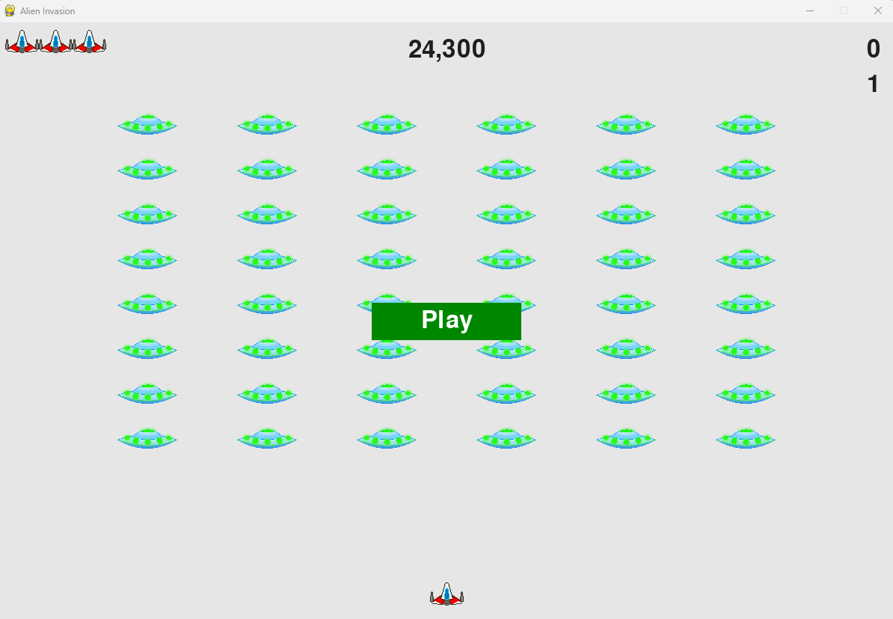
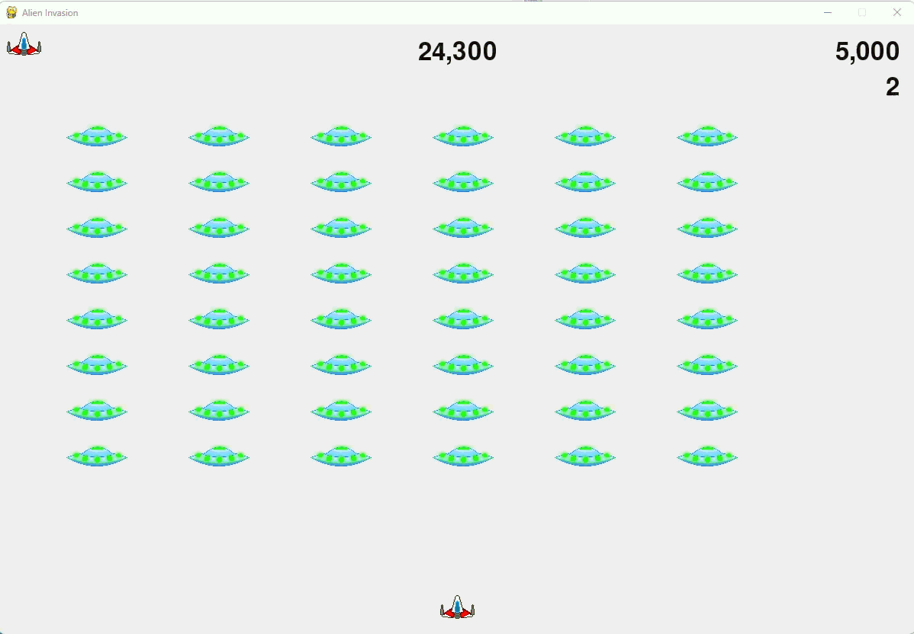

# Alien Invasion

A classic arcade shooter inspired by Space Invaders, built with Python and Pygame. Defend Earth from an advancing alien fleet across increasingly difficult levels, and try to beat your saved high score.

> Based on the project from _Python Crash Course_ by Eric Matthes, extended with alien fire, level progression, and persistent high scores.

## Features

- Smooth keyboard-controlled ship movement
- Bullet firing with collision detection
- Alien fleet that advances and drops at screen edges
- Aliens that fire back
- Level progression with rising speed and difficulty
- Live scoreboard showing score, high score, level, and remaining lives
- High score saved between sessions
- Start, game-over, and restart flow

## Requirements

- Python 3.8 or newer
- [Pygame](https://www.pygame.org/)

## Running the game

Click **Play** or press **P** to start.

## Controls

| Key       | Action               |
| --------- | -------------------- |
| `←` / `→` | Move ship left/right |
| `Space`   | Fire                 |
| `P`       | Start / restart game |
| `Q`       | Quit                 |

## Gameplay notes

- Clearing the fleet advances you to the next level, and aliens get faster and fire more often.
- You lose a life when an alien hits your ship or reaches the bottom of the screen.
- The game ends when you run out of lives. Press **P** to play again.
- Your high score is stored in `game_stats.txt`. Delete the file to reset it.
